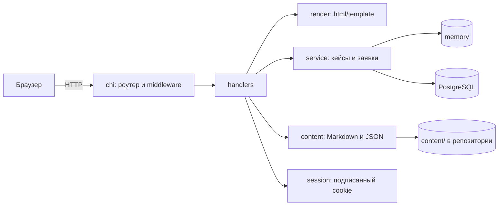
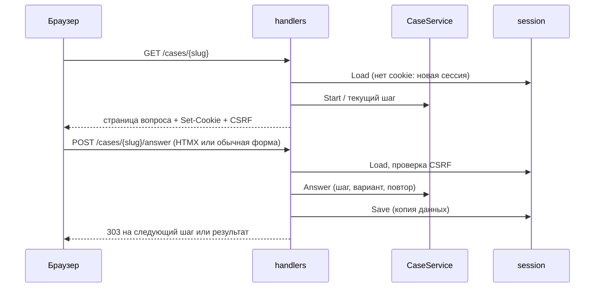

# Обзор архитектуры

**Статус:** Действует
**Владелец:** Tech Lead
**Обновлено:** 2026-11-13

Документ объясняет, из чего состоит GO-IT, как данные проходят через систему и где живёт состояние. Точные требования описаны в [спецификации](../product/specification.md), причины решений — в [ADR](adr/README.md).

## Контекст системы

GO-IT — один Go-процесс, который отдаёт HTML-страницы. Отдельного фронтенда и публичного API нет ([ADR-0001](adr/0001-server-side-rendering.md)). Состояние хранится в PostgreSQL (заявки и каталоги), в памяти процесса (сессии кейсов и форм) и в файлах репозитория (контент).

## Слои и пакеты

Зависимости направлены вниз: `handlers` знают о сервисах и хранилищах через интерфейсы, `domain` ни от чего не зависит.

| Пакет | Ответственность |
|-------|-----------------|
| `cmd/web` | Точка входа: конфигурация, сборка зависимостей, graceful shutdown (8 с) |
| `internal/config` | Переменные окружения, проверка секретов |
| `internal/domain` | Доменные типы без зависимостей (кейсы, ментор, заявка, roadmap, схема) |
| `internal/catalog` | Начальные данные: направления, менторы, волонтёрские задачи |
| `internal/cases` | Четыре кейса (Frontend, Backend, Project Manager, Product Manager) |
| `internal/service` | `CaseService` (ход прохождения, баллы, разбивка по темам), `ApplicationService` (проверка и сохранение заявок) |
| `internal/repository/memory`, `postgres` | Две реализации хранилища за общими интерфейсами; миграции встроены в бинарник ([ADR-0007](adr/0007-two-storage-backends.md)) |
| `internal/session` | Серверные сессии, подписанный cookie, CSRF-токен, срок жизни |
| `internal/content` | Загрузка Markdown (goldmark, санитизация bluemonday) и схем roadmap (строгий JSON) |
| `internal/http` | Роутер и цепочка middleware |
| `internal/http/handlers` | Публичные страницы, заявки, вход, кабинеты (`handlers.go`, `auth.go`, `lk.go`) |
| `internal/http/render` | Набор шаблонов на каждую страницу, функции шаблонов, буферизованный ответ |
| `internal/http/middleware` | Журнал запросов (slog) |
| `internal/docscheck` | Только тесты: проверка документации по [стандарту](../standards/documentation-standard.md) |

Шаблоны лежат в `templates/` (общий каркас `layouts/base.html`, фрагменты `partials/`, страницы `pages/`), статика — в `static/` (CSS, JS, шрифты, HTMX без внешних CDN).

## Жизненный цикл запроса

Цепочка middleware: `RequestID` → `RealIP` → `Recoverer` → `LimitBody` (1 МиБ) → `RequestLogger`. Затем роутер выбирает обработчик. Обработчик собирает данные, `render` целиком рендерит страницу в буфер и только после успеха отправляет ответ: ошибка шаблона даёт 500, а не обрезанную страницу. HTML отдаётся с `Cache-Control: no-store`, потому что в формах лежат токены.

## Где живёт состояние

| Состояние | Где | Срок жизни | Замечание |
|-----------|-----|------------|-----------|
| Заявки | PostgreSQL или память процесса | Постоянно (PostgreSQL) | Без `DATABASE_URL` данные пропадают при перезапуске |
| Менторы, задачи | Seed из `internal/catalog`, загружаются при старте | До следующего старта | Seed перезаписывает записи (технический долг) |
| Ход кейса, CSRF-токен | `session.Manager` в памяти процесса | 24 часа или до перезапуска | Cookie подписана; [ADR-0004](adr/0004-sessions-in-memory.md) |
| Контент roadmap и блога | Файлы `content/` | Версия репозитория | Читаются при каждом запросе |
| Кейсы и каталоги | Go-код | Версия сборки | |
| Решения по демо-заявкам в кабинетах | Параметр адреса `?h=` | Пока открыта ссылка | Сервер ничего не помнит ([ADR-0005](adr/0005-demo-auth-without-state.md)) |

## Основные потоки

### Прохождение кейса

С включённым JS форму отправляет HTMX и подменяет `#main`; без JS работает обычная форма с редиректом ([ADR-0002](adr/0002-htmx-progressive-enhancement.md)).

### Заявка ментору или волонтёру

`POST` с CSRF-токеном → `ApplicationService` проверяет поля (имя 2–100, контакт 3–254, сообщение до 2000) и существование цели → запись со статусом `new` → redirect `?sent=1`. При ошибке ответ 422 с сообщениями у полей.

### Вход и кабинеты

Вход ничего не проверяет: роль превращается в переход на `/lk/<роль>`. Кабинеты открываются по адресу и ничего не хранят ([ADR-0005](adr/0005-demo-auth-without-state.md)).

### Roadmap

`content.Loader` читает `<slug>.md` и `<slug>.diagram.json`, санитизирует HTML и строго валидирует схему. Страница собирается из введения, схемы и разделов; панель темы — `<dialog>` с запасным справочником без JS ([ADR-0006](adr/0006-roadmap-diagram-json.md)).

## Развёртывание

Docker Compose поднимает два сервиса: `web` (многоступенчатая сборка `golang:1.22-alpine` → `alpine:3.20`, пользователь `app`, порт 8080) и `postgres` (`postgres:16-alpine`, порт 5432, том `postgres_data`, проверка `pg_isready`). `web` стартует после здоровья БД, применяет встроенные миграции и загружает seed. Эксплуатация описана в [runbook](../engineering/runbook.md).

## Свойства и ограничения

| Свойство | Состояние |
|----------|-----------|
| Масштабирование | Один экземпляр: сессии в памяти процесса |
| Устойчивость | Graceful shutdown, `Recoverer`, таймауты сервера (ReadHeader 5 с, Read 15 с, Write 15 с, Idle 60 с) |
| Безопасность | CSRF на формах кейсов и заявок, санитизация Markdown, параметризованные SQL; вход и кабинеты открыты намеренно, см. [SECURITY](../../SECURITY.md) |
| Наблюдаемость | Журнал slog в stdout, `/health/live` и `/health/ready` |
| Данные | Нет персональных данных, кроме текста заявок |

## Связанные документы

- [Спецификация](../product/specification.md): требования, маршруты, модели данных
- [ADR](adr/README.md): причины решений
- [Дизайн-система](../design/design-system.md): темы и компоненты интерфейса
